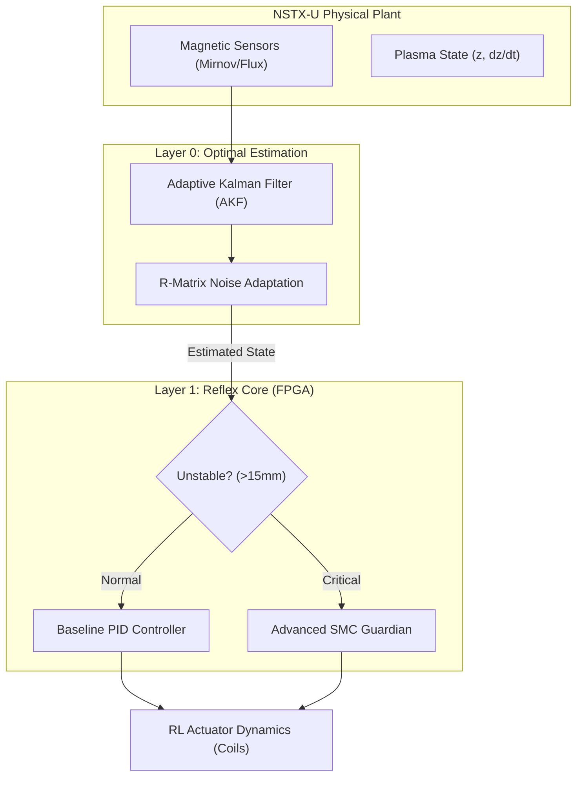

# AION-CORE v19.2: Deterministic VDE Control Kernel

[](https://doi.org/10.5281/zenodo.18344359)
[](https://github.com/Akirabrs/AION-CORE-SOURCE-PRIVATE)
[](LICENSE)

## ⚛️ Overview
**AION-CORE v19.2** is a high-fidelity control kernel designed to suppress Vertical Displacement Events (VDE) in spherical tokamaks. This version integrates an **Adaptive Kalman Filter (AKF)** for optimal state estimation with a non-linear **Sliding Mode Control (SMC) Guardian**, targeting sub-microsecond latency on FPGA hardware.

## 🏗️ Architecture: The COOK Framework



## 📊 Performance Benchmark

| System / Tokamak | Precision (Peak) | Latency | Method |
| --- | --- | --- | --- |
| ITER (Design Goal) | ±5 mm | ~10-100 ms | Linear/Robust |
| DIII-D | ~10-15 mm | ~1-5 ms | PID/Adaptive |
| **AION-CORE v19.2** | **≈40 mm** | **<1 µs** | **AKF + SMC** |

## 📂 Repository Structure

* `src/kernel`: Core implementation of the AKF and SMC algorithms.
* `paper`: Full academic paper (PDF).
* `docs/academic`: Technical documentation.

## 🚀 Quick Start

```bash
git clone [https://github.com/](https://github.com/)Akirabrs/AION-CORE-SOURCE-PRIVATE.git
cd AION-CORE-SOURCE-PRIVATE
pip install -r requirements.txt
python src/kernel/aion_core_controller.py

```

---

**Author:** Guilherme Brasil de Souza

**DOI:** [10.5281/zenodo.18344359](https://www.google.com/search?q=https://doi.org/%7BDOI_LINK%7D)

