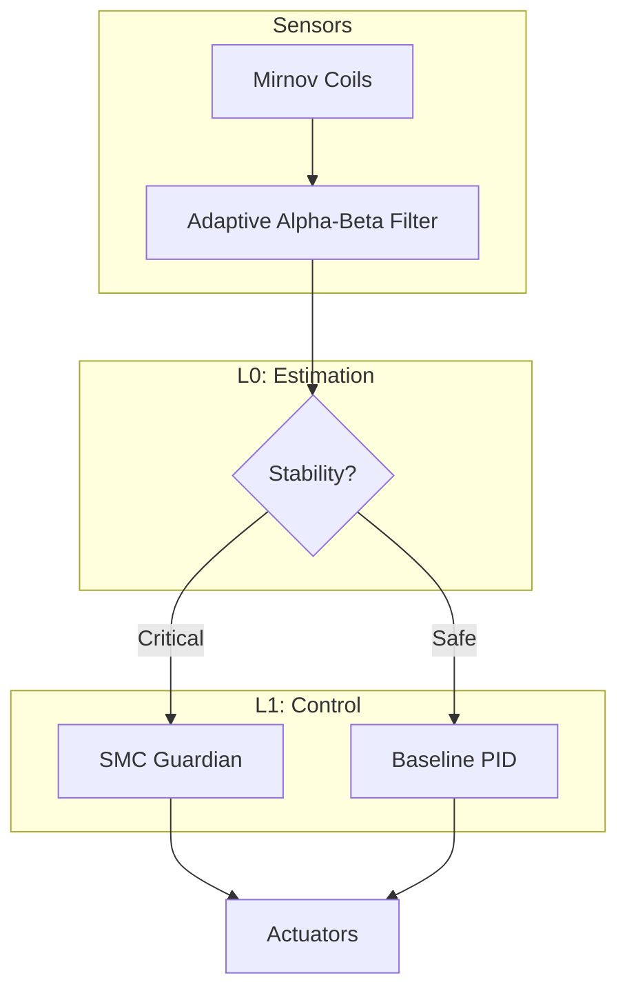

# AION-CORE v19.2: Deterministic VDE Control Kernel

  
  

## ⚛️ Overview
**AION-CORE v19.2** is a deterministic control kernel designed for sub-microsecond suppression of Vertical Displacement Events (VDE) in spherical tokamaks.

## 🏗️ Architecture

## 📂 Repository Structure

* `src/kernel/`: Core Python/HDL implementation.
* `docs/academic/`: Technical papers and LaTeX source files.

---

**Guilherme Brasil de Souza** | *v19.2 Release*
